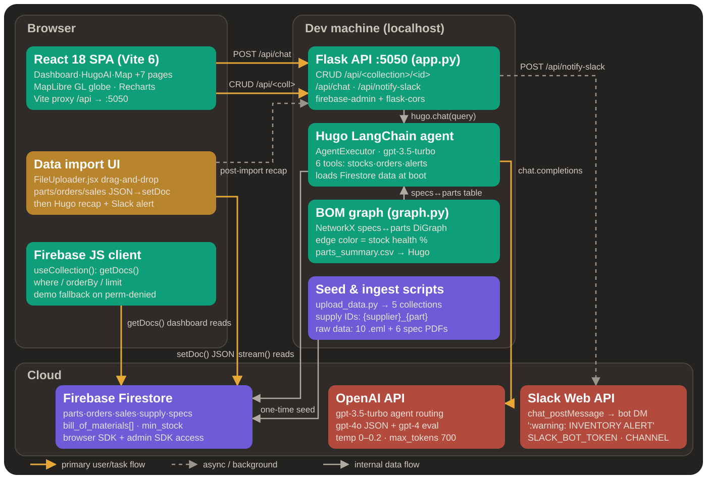

# Swerve – *Agentic Procurement, Built for Real Operations*

## System Architecture



## 1st Place – Dryft AI Challenge @ HackTech 2025


---

> **Procurement shouldn’t be a spreadsheet marathon. Swerve turns inventory, orders, and supplier data into fast, agent-guided decisions.**

---

## Table of Contents

* [What is Swerve?](#what-is-swerve)
* [The Problem](#the-problem)
* [The Solution](#the-solution)
* [Traction & Awards](#traction--awards)
* [🚀 Current Project Overview](#current-project-overview)
* [🎥 Demo Video](#demo-video)
* [🤖 AI-Assisted Automation Workflows](#ai-assisted-automation-workflows)
* [🧠 LangChain Agents (What We Actually Built)](#langchain-agents)
* [Accuracy and Guardrails](#accuracy-and-guardrails)
* [Data Handling and Security](#data-handling-and-security)
* [🛠️ Tech Stack at a Glance](#tech-stack)
* [🧱 System Architecture (High Level)](#system-architecture)
* [🔥 Core Features](#core-features)
* [🗄️ Firebase Database Schema](#firebase-database-schema)
* [🧪 Getting Started (Dev)](#getting-started-dev)
* [📁 Project Structure](#project-structure)
* [Contributing](#contributing)
* [License](#license)


---

## What is Swerve?

**Swerve** is an **agentic AI co-pilot** for industrial procurement and inventory operations, built as a comprehensive **Voltway electric scooter procurement management system**.

It helps teams:

* manage parts inventory
* track purchase orders
* analyze sales signals
* monitor supplier reliability
* automate low-stock and reordering workflows

Swerve is designed for **operational realism**—not just “chat with your database.”
It combines dashboard-first visibility with **LangChain-powered agents** that can reason over inventory and supply constraints and produce **actionable, auditable recommendations**.

---

## The Problem

Procurement teams face a familiar grind:

* inventory data is fragmented
* stock checks are manual
* reorder timing is inconsistent
* supplier reliability is hard to quantify quickly
* notifications arrive late (or not at all)

Even in smaller industrial settings, these gaps create:

* preventable downtime
* over-ordering or under-ordering
* long lead-time surprises
* reactive rather than proactive planning

---

## The Solution

**Enter Swerve.**

A unified procurement workspace that couples:

1. **Operational dashboards** (inventory, sales, suppliers, orders)
2. **Automation triggers** (low stock, blocked parts, lead-time risk)
3. **AI-assisted workflows** that guide decision-making step-by-step

The result is a system that **reduces human overhead** while preserving operator control.

---

## Traction & Awards

* **1st Place – Dryft AI Challenge @ HackTech 2025 (Caltech’s hackathon)**
* Built as the **Swerve – Voltway Procurement Management System**
* Post-hackathon, we were **flown out by the Dryft team** to their **San Francisco Neo offices** for continued collaboration (Neo-funded).

**Winner Image**

<p align="center">
  
  
</p>


**In-office Collaboration**

<p align="center">
  
  
</p>


---

<a id="current-project-overview"></a>

## 🚀 Current Project Overview

* **Objective:**
  Build an **AI-assisted procurement control center** that helps operations teams plan, order, and maintain parts inventory with higher confidence and lower effort.

* **Scope:**
  A realistic inventory + order + supplier system for **Voltway electric scooters**, with automation and analytics layered on top of Firestore-backed operational data.

* **What makes it different:**
  Swerve doesn’t just show data—it **turns data into decisions** using agentic workflows.

---

<a id="demo-video"></a>

## 🎥 Demo Video

A short walkthrough of the Swerve dashboard, inventory logic, and AI-guided procurement flows.

[](https://youtu.be/wa4kqvqhoZc?si=pmdlxND4N8W8MUx6)

---

<a id="ai-assisted-automation-workflows"></a>

## AI-Assisted Automation Workflows

Swerve uses **LangChain-powered agents** to automate repetitive procurement analysis while keeping decisions grounded in real operational data.

### Workflow Modules

1. **Inventory Health Automation**

   * Detects low stock, blocked parts, and min-stock violations.
   * Flags parts with high downstream impact via BOM relationships.

2. **Order Risk Automation**

   * Tracks late-risk using expected vs actual delivery patterns.
   * Highlights parts whose delays would stall high-volume models.

3. **Supplier Reliability Automation**

   * Ranks suppliers by reliability rating, lead time, and price signals.
   * Suggests fallback suppliers when risk increases.

4. **Demand-Aware Reorder Suggestions**

   * Connects recent sales trends to projected consumption.
   * Recommends reorder quantity and timing aligned to reorder intervals.

5. **Slack Insight Automation**

   * Converts key changes (low stock, delivery slippage, supplier risk)
     into concise team alerts.

---

<a id="langchain-agents"></a>

## 🧠 LangChain Agents (What We Actually Built)

Yes—**Swerve used agents.**

We integrated **LangChain** to orchestrate **tool-using agents** that can:

* retrieve live operational data
* reason across multiple collections
* generate structured recommendations
* trigger notifications
* produce procurement-ready summaries

### Why LangChain?

LangChain gave us a clean, modular way to:

* define tools (Firestore reads, analytics helpers, alert builders)
* chain reasoning steps across inventory + supplier + order signals
* maintain structured outputs that fit a real ops workflow

### Agent Behavior (High-Level)

Swerve’s procurement copilot is designed around a simple idea:

**You ask a procurement question → the system routes the task → a specialist agent pulls the right data → you get an actionable answer.**

Here’s the lifecycle:

1. **Engineer or ops user asks a question**

   * Example: “Are we at risk of running out of P301 next week?”
   * Or: “Which supplier is least reliable for motor assemblies?”

2. **A coordinator model identifies intent**

   * It determines whether this is primarily inventory risk, order tracking, supplier reliability, or sales-driven demand.

3. **The request is routed to a specialized LangChain agent**

   * **Inventory Agent**
   * **Orders Agent**
   * **Supplier Agent**
   * **Sales/Forecast Agent**
   * **Notifications Agent** (e.g., Slack summaries)

4. **That agent retrieves only task-relevant context**

   * Instead of loading the whole database, it queries **just** what’s needed:

     * part metadata, stock + min-stock,
     * open orders + lead times,
     * supplier reliability,
     * recent sales linked to impacted models.

5. **The agent uses tools to compute + explain**

   * The output is grounded in Firestore records and structured rules.

6. **Swerve returns a recommendation**

   * Clear next steps, supporting numbers, and assumptions when needed.

This makes Swerve **automation-first** without being a black box.


### Why Agents (Not Just One Chatbot)?

Agents let us:

* **constrain tool access by role**
* keep context **narrow and relevant**
* isolate logic per domain
* make the system easier to extend with new workflows.


---


## Accuracy and Guardrails

Swerve is designed for **operations-grade reliability**, not generic chat.

We improve accuracy through:

* **Tool-grounded answers**

  * Agents retrieve live, structured Firestore data rather than relying on memory.

* **Scoped context**

  * Each agent only loads the records required for the current task.

* **Rule + data validation**

  * Reorder suggestions check against:

    * `min_stock`,
    * `blocked` status,
    * lead time constraints,
    * BOM dependencies.

* **Structured outputs**

  * Responses are shaped into consistent formats
    (risk summary → evidence → recommended next action).

* **Graceful fallback**

  * When data is incomplete, Swerve surfaces assumptions explicitly
    and suggests what to verify next (e.g., missing orders or outdated supplier ratings).

---


## Data Handling and Security

Swerve follows a **least-privilege, operational-data-first** approach:

* **Firestore as source of truth**

  * Orders, parts, sales, and supplier metrics are stored with role-based access.

* **Secure auth**

  * Access is gated through Firebase Authentication.

* **Isolated file handling**

  * Any imported datasets or attachments are stored in Firebase Storage
    with scoped permissions tied to user roles.

* **Minimal AI data exposure**

  * Agents pass only the task-relevant fields to the model
    (not entire collections or raw dumps).

* **Audit-friendly design**

  * Recommendations can be traced back to
    part records, orders, supplier stats, and sales documents.

<a id="tech-stack"></a>

## 🛠️ Tech Stack at a Glance

### 🖼️ Frontend

* **React.js**
* **React Router**
* **Tailwind CSS**
* **Recharts**
* **Lucide React**
* **MapLibre GL**

### ☁️ Backend

* **Python**
* **Flask**
* **Firebase Admin SDK**

### 🧠 AI / Agents

* **LangChain** – agent orchestration and tool routing
* **Hugo AI** – custom procurement assistant layer
* **Slack Integration** – automation-ready alerts and summaries

### 🗄️ Database / Auth / Storage

* **Firebase Firestore**
* **Firebase Authentication**
* **Firebase Storage**

---

<a id="system-architecture"></a>

## 🧱 System Architecture (High Level)

```text
┌──────────────────────────────────────────────────────────────┐
│                         OPERATIONS UI                         │
├──────────────────────────────────────────────────────────────┤
│  • Procurement Dashboard                                      │
│  • Parts + BOM Explorer                                       │
│  • Orders & Delivery Tracking                                 │
│  • Supplier Reliability & Map                                 │
│  • AI Assistant Panel                                         │
└───────────────────────────────┬──────────────────────────────┘
                                │
┌───────────────────────────────▼──────────────────────────────┐
│                       REACT FRONTEND                          │
├──────────────────────────────────────────────────────────────┤
│  • Charts, alerts, and workflow views                         │
│  • Role-aware UX with Firebase Auth                            │
│  • Calls Flask endpoints for analytics + AI                    │
└───────────────────────────────┬──────────────────────────────┘
                                │
┌───────────────────────────────▼──────────────────────────────┐
│                        FLASK BACKEND                           │
├──────────────────────────────────────────────────────────────┤
│  • Inventory + order APIs                                     │
│  • Supplier analysis                                          │
│  • LangChain agent runtime + tool registry                    │
│  • Slack notification triggers                                │
└───────────────────────────────┬──────────────────────────────┘
                                │
┌───────────────────────────────▼──────────────────────────────┐
│                    FIREBASE DATA LAYER                         │
├──────────────────────────────────────────────────────────────┤
│  • Firestore: parts, orders, sales, supply                    │
│  • Storage: imports, assets                                   │
│  • Auth: ops roles                                            │
└──────────────────────────────────────────────────────────────┘
```

---

<a id="core-features"></a>

## 🔥 Core Features

### Dashboard

* Overview of key metrics
* Low stock alerts
* Inventory status visualization
* Sales charts
* Supplier reliability analysis
* Recent orders table

### Products

* View scooter models and their components
* Track parts inventory for each model
* Monitor stock levels and restock urgency

### Parts Management

* Track individual parts inventory
* View part details and specifications
* Monitor stock levels

### Orders

* Track purchase orders
* Monitor delivery status
* View order history

### Supply Chain Map

* Interactive global map
* Visualize suppliers and warehouses
* Track shipment routes

### Hugo AI Assistant

* AI-powered procurement assistant
* Get insights on inventory status
* Analyze supply chain data
* Optimize procurement processes

### Data Import

* Import parts, orders, and sales data
* Automatic database updates
* AI-powered analysis after import

### Notifications

* AI-generated parts status updates
* Low stock alerts
* Integration with Slack for team notifications

---

<a id="firebase-database-schema"></a>

## 🗄️ Firebase Database Schema

```plaintext
firestore/
├── orders/{order_id}                # e.g. orders/O5001
│   ├── {order_id}
│   │   ├── order_date: string
│   │   ├── expected_delivery_date: string
│   │   ├── actual_delivered_at: string
│   │   ├── part_id: string             # FK → parts/{part_id}
│   │   ├── supplier_id: string         # FK → supply/{supply_id}
│   │   ├── quantity_ordered: number
│   │   └── status: string              # "pending" | "ordered" | "delivered"
│
├── parts/{part_id}                  # e.g. parts/P301
│   ├── {part_id}
│   │   ├── part_name: string
│   │   ├── part_type: string           # "assembly" | "component"
│   │   ├── location: string
│   │   ├── stock_level: number
│   │   ├── min_stock: number
│   │   ├── blocked: boolean
│   │   ├── comments: string
│   │   ├── weight: number | null
│   │   ├── successor_part: string | null
│   │   ├── used_in_models: string[]    # e.g. ["S1_V1","S2_V1"]
│   │   ├── reorder_interval_days: number
│   │   ├── reorder_quantity: number
│   │   ├── bill_of_materials: array    # list of maps
│   │   │   ├── [0]
│   │   │   │   ├── Part_ID: string
│   │   │   │   ├── Part_Name: string
│   │   │   │   ├── Qty: number
│   │   │   │   └── Notes: string
│   │   │   ├── [1] { … }
│   │   │   └── …
│   │   └── requirements: string[]      # e.g. ["Torque motor mounting …", "Run battery BMS …"]
│
├── sales/{sale_id}                  # e.g. sales/S6000
│   ├── {sale_id}
│   │   ├── created_at: string
│   │   ├── accepted_request_date: string
│   │   ├── requested_date: string
│   │   ├── model: string
│   │   ├── version: string
│   │   ├── order_type: string          # "webshop" | "retail"
│   │   └── quantity: number
│
└── supply/{supply_id}               # e.g. supply/SupA_P301
    ├── {supply_id}
    │   ├── price_per_unit: number
    │   ├── lead_time_days: number
    │   ├── min_order_qty: number
    │   └── reliability_rating: number
```

---

<a id="getting-started-dev"></a>

## 🧪 Getting Started (Dev)

### Prerequisites

* Node.js (v16+)
* npm or yarn
* Python (v3.8+)
* Firebase account

### Frontend Setup

1. Clone the repository

   ```sh
   git clone https://github.com/your-username/voltway-procurement.git
   cd voltway-procurement
   ```

2. Install dependencies

   ```sh
   npm install
   ```

3. Create a `.env` file in the root directory with your Firebase configuration

   ```dotenv
   NEXT_PUBLIC_FIREBASE_API_KEY=your_api_key
   NEXT_PUBLIC_FIREBASE_AUTH_DOMAIN=your_auth_domain
   NEXT_PUBLIC_FIREBASE_PROJECT_ID=your_project_id
   NEXT_PUBLIC_FIREBASE_STORAGE_BUCKET=your_storage_bucket
   NEXT_PUBLIC_FIREBASE_MESSAGING_SENDER_ID=your_messaging_sender_id
   NEXT_PUBLIC_FIREBASE_APP_ID=your_app_id
   ```

### Backend Setup

1. Navigate to the backend directory

   ```sh
   cd backend
   ```

2. Create a virtual environment

   ```sh
   python -m venv venv
   source venv/bin/activate  # On Windows: venv\Scripts\activate
   ```

3. Install dependencies

   ```sh
   pip install -r requirements.txt
   ```

4. Create a `firebase-credentials.json` file with your Firebase service account credentials

### Running the Application

**Frontend**

```sh
npm run dev
```

The frontend will be available at `http://localhost:3000`.

**Backend**

```sh
python app.py
```

The backend API will be available at `http://localhost:5000`.

---

<a id="project-structure"></a>

## 📁 Project Structure

```plaintext
voltway-procurement/
├── src/
│   ├── components/       # Reusable UI components
│   ├── pages/            # Page components
│   ├── services/         # API and service functions
│   ├── hooks/            # Custom React hooks
│   ├── firebase.js       # Firebase configuration
│   └── App.jsx           # Main application component
├── backend/
│   ├── app.py            # Flask application
│   ├── routes/           # API routes
│   └── services/         # Backend services
└── public/               # Static assets
```

---

## Contributing

1. Fork the repository
2. Create a feature branch (`git checkout -b feature/amazing-feature`)
3. Commit your changes (`git commit -m 'Add some amazing feature'`)
4. Push to the branch (`git push origin feature/amazing-feature`)
5. Open a Pull Request

---

## License

This project is licensed under the MIT License - see the LICENSE file for details.
"""
